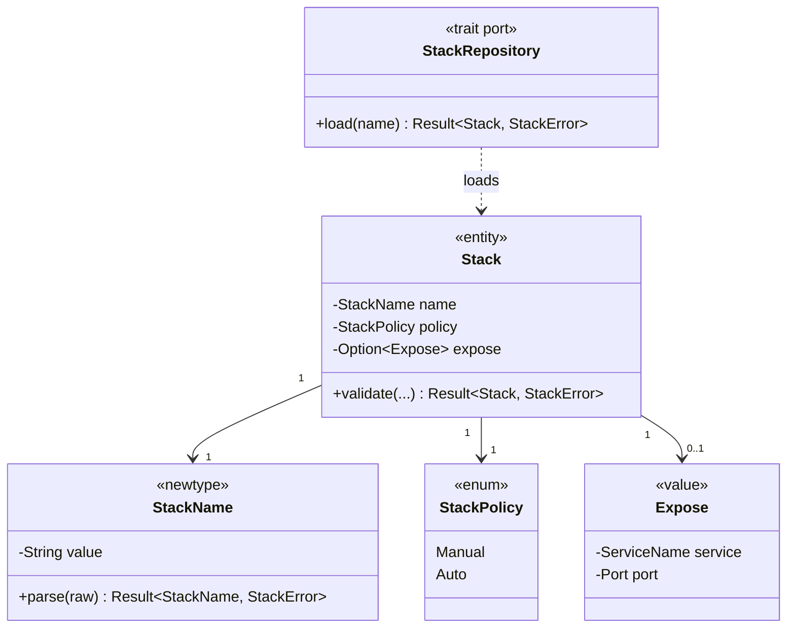

# SPDD REASONS Canvas

Generate an implementation-ready structured prompt using the REASONS Canvas, specialised for **Aegis**: a Rust Cargo workspace (controller, per-host agents, CLI) with clean architecture, strict clippy, arch-lint layer rules and behaviour-focused tests, built for GitOps of Docker Compose stacks over Tailscale.

**Input**: a GitHub issue whose body holds the analysis from `/spdd-analysis` under `## Analysis`, plus optional `@` reading material.

```text
/spdd-reasons-canvas #12
/spdd-reasons-canvas #12 @docs/notes.md
```

## Steps

1. **Resolve the work item (REQUIRED)**

   a. Extract the issue number from the input: `#12`, `GH-12`, an issue URL, or the `GH-<n>-` prefix of a referenced `spdd/prompt/` file. If there is none, ask the user. Never invent a number.

   b. Verify it with `gh issue view <n> --json number,title,state,body`. Not found → stop. Closed → warn and ask. The title and body, with `## Analysis`, are the business context.

   c. **Taxonomy.** `AGENTS.md` section 1 requires every issue to carry exactly one `type:` label, at least one `area:` label and a release milestone declared in `tools.toml`. Check them with `gh issue view <n> --json labels,milestone`. Warn, naming the missing field, and ask whether to continue.

   **Analysis check.** If the requirement has no `## Analysis` heading, stop and tell the user to run `/spdd-analysis #<n>` first. A canvas written from a bare requirement has no mapping onto the code, no decisions and no risks.

2. **Consolidate the context**

   - The requirement, including `## Analysis`, is the context. If the input adds requirement text the requirement lacks, ask the user to add it there first.
   - Read ALL `@` references completely (every relevant file in a folder). Report any that fail.
   - Do NOT summarise or truncate.

3. **Read the ground rules and the relevant code**

   Always read:
   - `AGENTS.md`: the canonical rules
   - `PRODUCT.md`: decisions and **non-goals**. A canvas never implements a non-goal.
   - Root `Cargo.toml` (workspace members, `[workspace.dependencies]`, `[workspace.lints]`)
   - `arch-lint.toml` (layer scopes and `restrict-use` rules)
   - `clippy.toml` (complexity, argument and nesting thresholds)
   - `tools.toml` (labels, milestones, issue templates, workflow statuses)
   - `justfile` (the check recipes)

   Then, scoped to the requirement:
   - The affected modules and their layers
   - The existing shared types to reuse before inventing new ones
   - The existing interfaces and implementations in the affected modules, and the tests and test doubles
   - The memory tools (`ai-memory` `memory_query`, `memory_recent`), for gotchas and prior decisions on the affected area. They are optional and advisory: if they are unavailable, say so in one line, and the repository documents win on any conflict.

4. **Apply the REASONS Canvas.** Generate fully populated content for all seven sections.

### R: Requirements

```text
## Requirements
- Issue: #<n> — <issue title>
[Concise verb phrases describing the essence of the requirement]

### Definition of Done
- [Observable, verifiable outcomes]

### Out of scope
- [Explicit exclusions, including relevant non-goals]
```

- What problem, for whom, and what value; the scope and what is explicitly not done
- Verb phrases ("Record…", "Derive…"); abstract the essential problem instead of listing features
- The core requirement fits in one sentence, and the Definition of Done is testable

### E: Entities

````text
## Entities

````

- Mark every type with a stereotype: `<<entity>>`, `<<value>>`, `<<newtype>>`, `<<enum>>`, `<<trait port>>`, `<<error>>`
- Under the diagram, note the owning crate and layer of each type
- **Primitives are wrapped**: domain fields are newtypes or value objects, never bare `String`, `bool` or integers.
- **Fields are private** (`-`), behaviour is public (`+`). No getters or setters.
- **Errors are types**: one `<<error>>` enum per layer boundary with its variants.
- **Domain stays pure**: wire formats (`aegis.toml`, compose YAML, CLI output) are modelled only where they cross an adapter.
- **IO is a port**: anything that touches Docker, SOPS, Tailscale or git is a `<<trait port>>` in `application`, implemented in `adapters`.

**Conservative constraints (CRITICAL)**: reuse existing types first; leave current types unchanged when they already meet the requirement; restructure only when the requirement cannot be met otherwise; extend rather than rebuild. No speculative abstractions.

### A: Approach

```text
## Approach
1. Domain design:
   - [Entities, value objects, invariants; key decisions and rationale]
2. Layer boundaries and flow:
   - [Which layer owns what; ports declared in `application`; how binaries wire adapters]
3. Error strategy:
   - [Error enums per layer; adapter → application mapping; what reaches the CLI or API]
4. Integration:
   - [`docker compose`, `sops`, `tailscale` and git adapters; process boundaries]
5. Test strategy:
   - [Behaviour tests through public ports with in-memory fakes; architecture tests]
6. Product and rules impact:
   - [Any conflict with `PRODUCT.md` non-goals or `AGENTS.md`, or "None"]
```

- Follow `AGENTS.md`
- Give the rationale for each decision and name the rejected alternatives
- Name the risks and how the design contains them

### S: Structure

```text
## Structure

### Crates and modules
1. `aegis-domain` — [new or changed entities and value objects]
2. `aegis-application` — [use cases, ports]
3. `aegis-adapters` — [port implementations]
4. `aegis`, `aegis-controller` or `aegis-agent` — [wiring only]

### Trait implementations
1. `ComposeStackRepository` implements `StackRepository`
2. `InMemoryStackRepository` implements `StackRepository` (test fake)

### Dependencies
1. [Use case] depends on [ports]
2. [Binary] provides [adapter] for [port]
3. New crate dependencies: [crate, version, which crate uses it] or "None"

### Boundary rules
1. [`arch-lint.toml` scopes or rules to add or confirm]
```

- Dependencies point inward: `domain` ← `application` ← `adapters` ← binaries (`cli`, `controller`, `agent`)
- `domain` is pure: no IO, process, environment, async runtime, HTTP, CLI, logging or serialization wire formats
- `application` depends only on `domain`, declares ports (traits) and does no IO
- `adapters` implement application ports and never depend on a binary
- Binaries only wire things together, hold no logic and never depend on each other
- Every component has exactly one home, and the dependency graph stays acyclic and within the boundary rules

### O: Operations

```text
## Operations

### 1. Create value object - `StackName` (`aegis-domain`)
1. Responsibility: [what it guarantees]
2. Representation: [private inner type and invariants]
3. Constructors: `parse(raw: &str) -> Result<StackName, StackError>` — [validation rules]
4. Behaviour: [methods, each with purpose and signature in prose]
5. Tests: [behaviour cases, named as behaviour]

### 2. Define port - `StackRepository` (`aegis-application`)
1. Contract: [methods, errors, guarantees]
2. Contract test suite: [cases every adapter must pass]

### 3. Implement use case - `ReconcileStack` (`aegis-application`)
1. Input: [command type]
2. Steps: [ordered logic, early returns, invariants]
3. Errors: [error enum variants and when]
4. Tests: [behaviour tests with fakes]

### 4. Implement adapter - `ComposeStackRepository` (`aegis-adapters`)
1. Implements: [port]
2. Error mapping: [adapter error → application error]
3. Tests: [runs the port contract suite]

### 5. Wire in the binary
### 6. Update boundaries - `arch-lint.toml`
### 7. Docs - `AGENTS.md` or `PRODUCT.md` when behaviour or rules change
### 8. Verify - `just check`
```

- **Order by dependency**: domain value objects → domain entities → application ports → use cases → adapters → binary wiring → `arch-lint.toml` boundaries → docs → verify
- Every operation names its crate and module, has one responsibility, and lists its tests (behaviour, not implementation)
- Write signatures in prose with inline code, never in code blocks (e.g. `parse(raw: &str) -> Result<StackName, StackError>`)
- The operations cover everything in Structure, with no logical gaps, and `/spdd-generate` can execute them directly
- **The last operation is always** `just check` passing with zero lint exceptions

### N: Norms

```text
## Norms
1. Baseline: `AGENTS.md` sections 2–5 apply in full (branches and commits, setup, architecture, code and test conventions)
   - Error handling
   - Naming
   - Documentation
   - Tests
```

- Do not restate `AGENTS.md`; reference it and add only what is specific to this change
- Zero lint exceptions: no `#[allow(...)]`, `#[expect(...)]` or any other lint suppression attribute. Design the code to fit the rule.
- Use the same patterns as the existing modules

### S: Safeguards

```text
## Safeguards
1. Functional: [invariants with exact conditions]
2. Product: [`PRODUCT.md` decisions and non-goals respected, for example no implicit data deletion]
3. Architecture: [layer rules; `arch-lint.toml` rules]
4. Lints: [clippy and arch-lint pass with zero exceptions; `clippy.toml` thresholds]
5. Errors: [exact error enum variants and Display messages]
6. Security and privacy: [no secrets or plaintext `.env` content in logs, errors or tests]
7. Tests: [required behaviour tests and contract suites]
```

- Each safeguard can be checked by a test, by `just check`, or by review; quantify where possible
- Error messages written here are copied verbatim by `/spdd-generate`

5. **Construct the structured prompt**

   ```text
   # [Derived Requirement Title]

   - Issue: #<n>
   - Analysis: the `## Analysis` section of issue #<n>
   ```

   Then all seven sections, fully populated and in order. **Do NOT include** the raw business context, framework metadata (objective, guidance, quality standards), a timestamp or the framework name. No placeholders or TODOs.

   **No code blocks (CRITICAL)**: no source-language blocks, type or function bodies, query statements or config snippets. Describe signatures in prose with inline code. Mermaid diagrams are allowed.

6. **Save the canvas**

   a. File name: `GH-<n>-{TIMESTAMP}-[{ACTION}]-{scope}-{description}.md`. `TIMESTAMP` is `YYYYMMDDHHmm`. `ACTION` is one of `[Feat]`, `[Fix]`, `[Refactor]`, `[Test]`, `[Docs]`, `[Chore]`. `scope` is the most affected of `domain`, `application`, `adapters`, `cli`, `controller`, `agent`, or `workspace` / `tooling`. `description` is kebab-case, < 10 words.

   b. Create `spdd/prompt/` if it is missing, and write the file there.
   The canvas is an ephemeral working file for the current branch. `spdd/prompt` is gitignored: never stage it, never commit it, and never name it by path in a commit message, an issue or a pull request (write `#<n>` in prose).

   c. **Existing or lost canvas.** If a canvas for this work item already exists, ask whether to update it with `/spdd-prompt-update` instead of writing a second one.
   If it is missing partway through a branch (recreated worktree, new checkout, a switch of agent), regenerate it from `## Analysis` and the code already written (`git diff main...HEAD`), and say that it was regenerated, since it may differ from the first. Anything only the lost canvas knew belongs in the code, the tests or the design docs.

   **Stale canvas.** If the branch code changed outside the canvas (review fixes, a hand refactor) and more code will be generated from it, rebuild it the same way, with the canvas as a third input. Code wins over the old canvas, and every difference is listed for the user. There is no separate sync step: the canvas only has to be right for the rest of this branch.

   d. Show a summary: the path, a one-line summary of each section, the counts of types, operations and safeguards.

7. **Ask before implementing**: "The REASONS Canvas is ready. Proceed with `/spdd-generate`?"

## Markdown output

Everything this skill writes must pass `rumdl check`. Every fenced block has a language (`text`, `mermaid`). Use real headings, never bold lines. Put blank lines around headings, lists and fences.

## Guardrails

- **CRITICAL**: generate fully populated content for all seven sections, never just headers
- Do NOT proceed without a resolved work item, or without `## Analysis`
- Do NOT include framework metadata, code blocks, placeholders or TODOs
- Do NOT implement code before the user confirms the canvas
- The file name MUST follow the convention above
- Never stage or commit a file under `spdd/prompt`, and never name a canvas by path outside the working tree
- Every operation MUST name its crate and module and list its tests
- Conservative entity design: reuse existing types and avoid unnecessary refactoring
- Read ALL `@` references completely and merge them with the requirement into one context, preserving its intent
